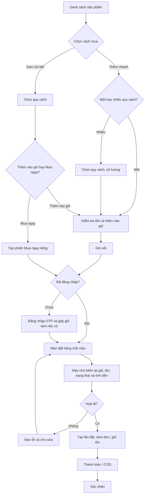

# SRS – Trải nghiệm chọn mua hàng (Phase 2)

Nov 4, 2026 · @Hoàng Trần

## 1. Giới thiệu

Tài liệu này đặc tả trải nghiệm chọn mua hàng trên website và app web Phase 2: khách vuốt ngang để xem sản phẩm, xem ảnh 3D, chọn và đặt hàng với ít thao tác hơn, trên giao diện công nghệ và sang trọng. Đây là bản bổ sung: luồng nghiệp vụ và quy tắc mua hàng, thanh toán đã có trong BRD Luồng mua hàng và Preorder và Đặc tả UC – Module Mua hàng và Thanh toán vẫn áp dụng (dẫn chiếu ở mục 5.3). Phần mới là cách khách thao tác và cách sản phẩm được trưng bày.

| Hạng mục | Nội dung |
| --- | --- |
| Trong phạm vi | Khách và vãng lai trên website và app web (D1): trang chủ, danh mục, chi tiết sản phẩm, xem 3D và ảnh 360°, chọn quy cách, giỏ hàng, đặt hàng, xác nhận. Admin – Chất lượng tải lên và duyệt ảnh, video, ảnh 360°, mô hình 3D |
| Ngoài phạm vi | Xử lý đơn phía nhà cung cấp, Admin, shipper (giữ theo SRS hợp nhất); chọn đơn vị cổng thanh toán (SRS hợp nhất, mục 10); xem sản phẩm qua camera (AR) ở đợt 2 (D17); sản xuất nội dung 3D (kế hoạch Phase 2, phần việc Data, Marketing); thiết kế kỹ thuật như kiểu dữ liệu, API, cách hẹn giờ, chuẩn nén (tài liệu thiết kế của Dev) |
| Căn cứ | (1) BRD Luồng mua hàng và Preorder (29/09). (2) SRS hợp nhất: FR-TKSP-01 đến 10, FR-MHTT-01 đến 07, FR-SP-01 đến 09. (3) Đặc tả UC – Module Mua hàng và Thanh toán: BR-MHTT, AC-MHTT, MSG-MHTT. (4) Đặc tả tài khoản: BR-ACC. (5) Quyết định 02/11 (D1–D8): website và app web, chỉ giao Hà Nội, tách đơn theo nhà cung cấp, sàn mua đứt, chỉ hàng Lào Cai. (6) Yêu cầu của sếp 04/11: tối ưu thao tác chọn mua, vuốt ngang, hình 3D, công nghệ và sang trọng. (7) Bản thẩm định SRS và quyết định D13–D18 ngày 04/11 (mục 10, phụ lục A). (8) Mã nguồn app bản 02/11 |
| Điểm khác BRD | BRD lấy ví dụ sản phẩm Bắc Giang, nay chỉ hàng Lào Cai. "HTX" trong BRD nay là "nhà cung cấp" (gồm doanh nghiệp, hộ kinh doanh có giấy tờ). Sàn mua đứt nên khách trả tiền cho sàn. BRD cho tối đa 5 ảnh; chuẩn dữ liệu Phase 2 cần từ 5 ảnh trở lên. BRD bắt đăng nhập trước khi thêm vào giỏ; nay cho thêm trước, đăng nhập khi đặt (D15) |

Cách đọc: mã yêu cầu nối tiếp danh mục SRS hợp nhất. Ưu tiên gồm Must (bắt buộc), Should (nên có), Could (có thì tốt). Cột Duyệt ghi "Đã chốt" khi đã có căn cứ duyệt, "Chờ duyệt" khi chưa được làm. Nhãn (ĐX) là đề xuất của BA, (GĐ) là giả định. Mọi yêu cầu Must phải "Đã chốt" trước cổng C1 (27/11) thì SRS mới chốt baseline.

### Thuật ngữ

| Thuật ngữ | Nghĩa trong tài liệu này |
| --- | --- |
| Vãng lai | Người dùng chưa đăng nhập |
| Khách | Khách hàng đã đăng nhập |
| App web | Bản web tối ưu cho điện thoại, mở trên trình duyệt và dùng như app; không tải từ kho ứng dụng. (GĐ) Dev xác nhận có cho thêm ra màn hình chính không |
| Mã gốc | Một sản phẩm, ví dụ "Mật ong bạc hà". Ảnh chung, câu chuyện, chứng nhận gắn vào mã gốc |
| Mã bán (quy cách) | Một cách bán của mã gốc, ví dụ "hũ 500 g", có giá, tồn, trạng thái riêng. Trên màn hình gọi là quy cách |
| Quy cách mặc định | Quy cách đầu tiên còn hàng theo thứ tự Admin sắp. Không còn quy cách nào còn hàng thì là quy cách đầu tiên mở đặt trước |
| Tồn có thể bán | Hàng có sẵn ở kho Hà Nội của sàn trừ phần đang giữ cho đơn chờ thanh toán (BR-MN-10) |
| Suất đặt trước | Số lượng còn nhận đặt trước của một quy cách |
| Lần đặt | Một lần khách bấm Đặt hàng; có một mã lần đặt, gồm một hoặc nhiều đơn (D13) |
| Đơn | Phần của lần đặt thuộc một nhà cung cấp và một loại (Mua thường hoặc Đặt trước); dùng để xử lý và đối soát |
| Phiên Mua ngay | Màn đặt hàng chỉ gồm món khách đang xem, mở từ nút Mua ngay; không đụng tới giỏ (BR-MN-04) |

### Lịch sử phiên bản

| Bản | Ngày | Nội dung |
| --- | --- | --- |
| 1.2 (nháp) | 07/11/2026 | [v1.2-ĐX] Bổ sung thay đổi phạm vi đa vùng, làm rõ điểm chưa thống nhất, thiết kế token/theme/chuyển động, thông báo/trạng thái, dữ liệu đo và các vấn đề phát hiện khi rà repo; chờ BA duyệt |
| 1.1 | 04/11/2026 | Sửa theo bản thẩm định: bỏ 4 chỗ mâu thuẫn; thêm tác nhân Vãng lai, thuật ngữ, cột Duyệt, dẫn chiếu quy tắc đã có; quy tắc mới BR-MN-11 đến 13, BR-PT-06, 07; sửa dữ liệu ảnh và 3D, NFR 3D; thêm US-10 đến 12 và 5 kịch bản kiểm thử; ghi quyết định D13–D18 |
| 1.0 | 04/11/2026 | Bản đầu |

## 2. Hiện trạng và mục tiêu

App hiện tại đã mua được nhưng cần khoảng 5–6 lần chạm và 3 bước đặt hàng cho một món; Phase 2 đưa xuống còn 3 lần chạm và 1 màn đặt hàng. Hiện trạng dưới đây đọc từ mã nguồn app bản 02/11; số lần chạm là BA đếm theo mã, Dev xác nhận lại khi làm.

| Điểm | Hiện trạng (bản 02/11) | Vấn đề |
| --- | --- | --- |
| Xem danh sách | Trang chủ theo mẫu Stitch (nền sáng, banner xanh rừng), sản phẩm dạng thẻ; chưa có băng chuyền vuốt ngang | Muốn mua phải mở chi tiết từng món |
| Xem chi tiết | Bảng trượt từ dưới lên; ảnh phụ là ô nhỏ, bấm từng ảnh để xem; chưa có video, ảnh xoay 360°, 3D | Khó cảm nhận sản phẩm; chưa "công nghệ" như sếp muốn |
| Thêm vào giỏ | Bắt buộc đăng nhập trước khi thêm (đúng BRD ngoại lệ 4) | Khách mới bị chặn ngay khi vừa muốn mua |
| Đặt hàng | 3 bước: Giao hàng → Ưu đãi và thanh toán → Xác nhận | Nhiều lần bấm "Tiếp tục" dù khách quay lại đã có địa chỉ mặc định |
| Địa chỉ giao | Sổ địa chỉ cho gõ tự do tỉnh/thành và phường/xã; BA chưa thấy chỗ chặn địa chỉ ngoài Hà Nội ở bước đặt hàng | Chưa bảo đảm D2 (chỉ giao Hà Nội); Dev xác nhận |

| Chỉ số | Hiện tại | Mục tiêu | Cách đo |
| --- | --- | --- | --- |
| Lần chạm từ thẻ sản phẩm đến đặt xong | 5–6 | ≤ 3 | Kịch bản US-04. Điều kiện: khách đã đăng nhập, có địa chỉ mặc định và phương thức lần trước; món đặt theo quy cách mặc định, 1 đơn vị, dùng Mua ngay. Đếm đến khi đơn được tạo (trả khi nhận) hoặc khi chuyển sang trang thanh toán; không tính thao tác trong ứng dụng ngân hàng |
| Lần chạm để thêm vào giỏ từ danh sách | Phải mở chi tiết rồi bấm thêm | 1 (món 1 quy cách); 2 (nhiều quy cách) | Kiểm thử US-02 |
| Số màn đặt hàng | 3 bước | 1 màn | Kiểm thử US-06 |
| Tỷ lệ mở chi tiết → thêm vào giỏ; tỷ lệ có xem 3D → thêm vào giỏ | Chưa đo | Đặt mức sau 2 tuần chạy thử đợt 2 | Sự kiện đo ở mục 6 |
| Giao diện "công nghệ, sang trọng" | Chưa có tiêu chí | Sếp duyệt bản mẫu bấm thử được trước cổng C2 (18/12) | Biên bản duyệt |

## 3. Quy trình chọn mua mới

Khách có hai đường vào giỏ: thêm nhanh ngay từ thẻ, hoặc xem kỹ ở trang chi tiết rồi bấm Mua ngay; cả hai dồn về một màn đặt hàng.

&#91;embedded content: Luồng chọn mua mới · 2 đường vào giỏ, 1 màn đặt hàng\]

Sơ đồ chỉ vẽ thao tác của khách. Các bước hệ thống làm ngầm theo BRD và Đặc tả UC Mua hàng – Thanh toán: kiểm tra tồn khi thêm; chọn nút theo trạng thái hàng (Mua ngay, Đặt trước, Hết hàng); kiểm tra lại giá, tồn khi mở màn đặt hàng và khi bấm Đặt hàng; tách đơn theo nhà cung cấp và loại trong một lần đặt; thanh toán gộp một lần và giữ đơn 15 phút. Vãng lai đi được tới giỏ; bấm Đặt hàng ở giỏ hoặc Mua ngay thì đăng nhập OTP trước, xong mở đúng màn đặt hàng (D15).

## 4. Yêu cầu chức năng

18 yêu cầu mới, chia 4 nhóm; cả 13 yêu cầu Must đã có căn cứ duyệt. Các yêu cầu cũ vẫn giữ: kiểm tra tồn khi thêm vào giỏ, giỏ hai nhóm Mua thường và Đặt trước, tách đơn, thanh toán gộp một lần, giữ đơn 15 phút (FR-MHTT-01 đến 07). FR-MHTT-14 gộp 3 bước của FR-MHTT-02 (đặt hàng) và FR-MHTT-05 (thanh toán) vào một màn, giữ nguyên mọi bước kiểm tra của hai yêu cầu đó (mục 5.3).

### A. Xem sản phẩm: vuốt ngang, 3D

| Mã | Hệ thống phải | Tác nhân | Ưu tiên | Duyệt | Nguồn |
| --- | --- | --- | --- | --- | --- |
| FR-TKSP-11 | Hiện băng chuyền thẻ sản phẩm vuốt ngang theo chủ đề (Đang vào vụ, Bán chạy, Quà biếu) trên trang chủ và trang danh mục; một sản phẩm thuộc được nhiều chủ đề, mỗi chủ đề có thứ tự riêng. Thẻ lớn gồm ảnh, tên, vùng, giá, nút thêm nhanh; giá và nút theo quy cách mặc định, sản phẩm nhiều mức giá ghi "từ …₫". Mỗi băng chuyền tối đa 12 thẻ, thẻ cuối là "Xem tất cả" (ĐX). Vuốt dừng đúng từng thẻ; thẻ kế tiếp lộ một phần. Máy tính có nút mũi tên, kéo chuột và phím ← → | Vãng lai, Khách | Must | Đã chốt | Sếp 04/11; mở rộng FR-TKSP-06 |
| FR-TKSP-12 | Hiện thư viện vuốt ngang trên trang chi tiết: ảnh, video, ảnh 360°, 3D theo thứ tự BR-PT-05; chấm chỉ vị trí; chạm hai lần hoặc chụm hai ngón để phóng to; bấm để mở toàn màn hình. Ô 3D và ô 360° chỉ hiện ảnh đại diện, chạm mới kích hoạt (BR-PT-06). Đổi quy cách thì thư viện chuyển tới ảnh của quy cách đó nếu có | Vãng lai, Khách | Must | Đã chốt | Sếp 04/11; thay ô ảnh nhỏ hiện tại |
| FR-TKSP-13 | Cho xem 3D khi sản phẩm có mô hình đã duyệt: nút "Xem 3D" trên ảnh chính và ô 3D trong thư viện. Chỉ tải mô hình khi khách chạm một trong hai chỗ đó; trong lúc tải hiện ảnh đại diện và vòng tiến trình. Xoay bằng một ngón, phóng to bằng hai ngón, có nút đặt lại góc nhìn và nút Đóng; tự xoay chậm khi hiện xong, dừng khi khách chạm. Đóng 3D hoặc sang sản phẩm khác thì giải phóng bộ nhớ (NFR-MN-09) | Vãng lai, Khách | Must (với sản phẩm có 3D) | Đã chốt | Sếp 04/11 |
| FR-TKSP-14 | Cho xem ảnh xoay 360° với sản phẩm chưa có 3D: chạm để kích hoạt rồi kéo ngang để xoay theo bộ ảnh chụp quanh sản phẩm (24–36 ảnh, ĐX) | Vãng lai, Khách | Should | Chờ duyệt | (ĐX) cách làm rẻ hơn 3D |
| FR-TKSP-15 | Cho đặt sản phẩm 3D vào không gian thật qua camera (AR) trên điện thoại hỗ trợ | Vãng lai, Khách | Could | Làm sau (D17) | (ĐX) |
| FR-TKSP-16 | Cho chuyển sang sản phẩm trước hoặc sau trong cùng danh sách từ trang chi tiết, bằng nút mũi tên hoặc vuốt ngang ở vùng tên sản phẩm; giữ nguyên bộ lọc. Mở từ đường dẫn chia sẻ (không có danh sách) thì ẩn nút | Vãng lai, Khách | Should | Chờ duyệt | (ĐX) thử trên bản mẫu để không nhầm với vuốt ảnh |

### B. Chọn mua nhanh

| Mã | Hệ thống phải | Tác nhân | Ưu tiên | Duyệt | Nguồn |
| --- | --- | --- | --- | --- | --- |
| FR-MHTT-08 | Cho thêm nhanh từ thẻ: món 1 quy cách thêm ngay 1 đơn vị, báo nhỏ kèm nút "Hoàn tác" trong 5 giây (BR-MN-11); món nhiều quy cách mở bảng chọn nhanh với quy cách mặc định (quy cách, số lượng, giá, Thêm vào giỏ, Mua ngay) | Vãng lai, Khách | Must | Đã chốt | Sếp 04/11 |
| FR-MHTT-09 | Cho chọn quy cách bằng nút chip, quy cách mặc định được chọn sẵn khi mở trang (BR-MN-01); đổi chip thì giá, tình trạng hàng, ngày giao dự kiến, nút mua và ảnh quy cách cập nhật ngay, không tải lại trang | Vãng lai, Khách | Must | Đã chốt | BRD bước 4 |
| FR-MHTT-10 | Giữ thanh mua dính đáy trên trang chi tiết, luôn hiện khi cuộn: giá, số lượng, nút chính "Mua ngay" hoặc "Đặt trước" (tô màu), nút phụ "Thêm vào giỏ" (chỉ có viền). Hàng đặt trước ghi thêm số tiền cọc. Hết hàng và không mở đặt trước thì chỉ hiện "Hết hàng" | Vãng lai, Khách | Must | Đã chốt | Sếp 04/11 |
| FR-MHTT-11 | Hiện giỏ nổi: biểu tượng giỏ có số món; mở dạng bảng trượt để sửa số lượng, xoá (vuốt trái hoặc nút xoá, có hoàn tác), xem tạm tính theo nhóm Mua thường và Đặt trước; đi đặt hàng mà không rời trang đang xem | Vãng lai, Khách | Must | Đã chốt | Mở rộng FR-MHTT-01 |
| FR-MHTT-12 | Cho vãng lai thêm vào giỏ (giỏ tạm trên thiết bị, BR-MN-05). Vãng lai bấm Đặt hàng ở giỏ thì đăng nhập OTP, gộp giỏ rồi mở màn đặt hàng | Vãng lai | Must | Đã chốt (D15) | Đổi BRD ngoại lệ 4 |

### C. Đặt hàng

| Mã | Hệ thống phải | Tác nhân | Ưu tiên | Duyệt | Nguồn |
| --- | --- | --- | --- | --- | --- |
| FR-MHTT-13 | Cho Mua ngay: mở phiên Mua ngay chỉ với món và quy cách đang chọn (BR-MN-04); giỏ hiện có giữ nguyên trong mọi trường hợp. Vãng lai bấm Mua ngay thì đăng nhập OTP trước, xong mở đúng phiên Mua ngay của món đó | Vãng lai, Khách | Must | Đã chốt | Sếp 04/11 |
| FR-MHTT-14 | Đặt hàng trên một màn: địa chỉ, cách giao, thanh toán, mã ưu đãi, tóm tắt lần đặt và các đơn sẽ tách (BR-MN-07); sửa từng phần bằng bảng trượt tại chỗ. Đổi địa chỉ, cách giao, thanh toán hoặc mã ưu đãi thì tính lại ngay phí giao, tiền giảm và số tiền. Nút Đặt hàng ghi "Trả ngay …₫"; có đơn trả khi nhận thì ghi thêm "Trả khi nhận …₫" (BR-MN-08). Kiểm tra lại giá, tồn, trạng thái bán khi mở màn và khi bấm (BR-MHTT-03) | Khách | Must | Đã chốt | Thay 3 bước của FR-MHTT-02, 05 |
| FR-MHTT-15 | Lấy sẵn địa chỉ mặc định, cách giao và phương thức thanh toán lần trước. Khách chưa có địa chỉ thì màn đặt hàng mở ngay bảng thêm địa chỉ; chưa có lần trước thì khách tự chọn cách giao và thanh toán | Khách | Must | Đã chốt | Sếp 04/11 |
| FR-MHTT-16 | Hiện màn xác nhận: mã lần đặt, mã từng đơn, số tiền đã trả và còn trả khi nhận, ngày giao dự kiến, nút Theo dõi đơn và Mua tiếp | Khách | Must | Đã chốt | BRD bước 8; D13 |
| FR-MHTT-17 | Cho mua lại: từ đơn đã giao, một chạm thêm lại vào giỏ các món còn bán, theo giá hiện tại; món đã hết hoặc ngừng bán thì bỏ qua và báo | Khách | Should | Chờ duyệt | (ĐX) |
| FR-MHTT-18 | Với món hết hàng và không mở đặt trước: hiện nút "Báo khi có hàng" | Vãng lai, Khách | Could | Chờ duyệt (ĐX làm sau đợt 2) | (ĐX); BRD ngoại lệ 3 chỉ báo hết |

### D. Quản trị hình ảnh, 3D

| Mã | Hệ thống phải | Tác nhân | Ưu tiên | Duyệt | Nguồn |
| --- | --- | --- | --- | --- | --- |
| FR-SP-10 | Cho tải lên ảnh, video, bộ ảnh 360°, cặp tệp 3D (cho web và cho iPhone); ảnh đại diện cho video, 360°, 3D; tự nén ảnh; kiểm tra định dạng và dung lượng (BR-PT-03); xem trước; chọn nhóm ảnh và sắp thứ tự; ghi nguồn, tải tệp phiếu đồng ý; duyệt trước khi hiển thị. Chọn "Cần sửa" thì bắt buộc ghi lý do; thay tệp đã duyệt thì bản mới phải duyệt lại (BR-PT-07) | Admin – Chất lượng (Data gửi tệp) | Must | Đã chốt | Cần cho FR-TKSP-12, 13 |

## 5. Quy tắc nghiệp vụ

Hai nhóm quy tắc mới: BR-MN cho mua nhanh (13 quy tắc), BR-PT cho hình ảnh và 3D (7 quy tắc). 90 quy tắc cũ trong SRS hợp nhất và các quy tắc BR-MHTT ở Đặc tả UC Mua hàng – Thanh toán vẫn áp dụng; mục 5.3 chỉ ra quy tắc nào xử lý tình huống nào.

### 5.1. Mua nhanh

| Mã | Quy tắc | Nguồn |
| --- | --- | --- |
| BR-MN-01 | Quy cách mặc định là quy cách đầu tiên còn hàng theo thứ tự Admin sắp (mục 1). Trang chi tiết và bảng chọn nhanh luôn chọn sẵn quy cách mặc định. Thêm nhanh: sản phẩm chỉ có 1 mã bán còn hàng thì thêm thẳng 1 đơn vị; có nhiều mã bán thì mở bảng chọn | (ĐX) |
| BR-MN-02 | Mọi cách thêm (thẻ, bảng chọn, chi tiết, mua lại, gộp giỏ) đều kiểm tra: số đã có trong giỏ cộng số thêm không vượt tồn có thể bán, hoặc số suất đặt trước còn nhận. Vượt thì không thêm và báo số còn có thể thêm | BRD ngoại lệ 1; D4 |
| BR-MN-03 | Trạng thái hàng quyết định nút: còn hàng → "Mua ngay"; chưa vào vụ hoặc hết nhưng mở đặt trước → "Đặt trước"; hết và không mở đặt trước → "Hết hàng", không cho thêm. Thẻ sản phẩm hiện nhãn và nút theo quy cách mặc định | BRD bước 4 |
| BR-MN-04 | Mua ngay mở phiên đặt hàng riêng chỉ gồm món đang xem. Phiên kết thúc khi đặt xong, khi khách quay lại hoặc rời màn đặt hàng; không lưu lại. Giỏ không bị xoá, không bị gộp thêm món trong mọi trường hợp. Đơn từ Mua ngay hết hạn thanh toán thì món không tự vào giỏ (ngoại lệ của BR-MHTT-25); thông báo có nút "Mua lại" | (ĐX) |
| BR-MN-05 | Giỏ tạm của vãng lai lưu trên từng thiết bị, hết hạn sau 7 ngày kể từ lần sửa cuối; không chứa thông tin cá nhân. Mỗi quy cách một dòng, thêm trùng thì cộng số lượng. Khi đăng nhập, giỏ tạm gộp vào giỏ tài khoản (giỏ tài khoản dùng chung trên mọi thiết bị đã đăng nhập): trùng quy cách thì cộng số lượng, vượt tồn thì giảm về số tồn và báo; gộp xong thì xoá giỏ tạm | D15; 7 ngày là (GĐ) |
| BR-MN-06 | Chỉ giao trong Hà Nội. Khách chọn phường/xã từ danh mục Hà Nội theo đơn vị hành chính hiện hành, không gõ tự do. Địa chỉ ngoài Hà Nội: báo MSG-MHTT-04, không cho đặt, mời để lại số điện thoại để nhận tin khi mở vùng giao (có ô đồng ý nhận tin) | D2; AC-MHTT-07 |
| BR-MN-07 | Mỗi lần đặt có một mã lần đặt. Hệ thống tách đơn theo nhà cung cấp và loại (Mua thường, Đặt trước); đơn đặt trước tách thêm theo ngày giao (BR-MHTT-02). Khách thấy mã lần đặt và các đơn bên trong. Hàng có sẵn đi cùng một chuyến từ kho Hà Nội chỉ tính một phí giao cho cả lần đặt; mỗi chuyến đặt trước tính phí riêng. Màn đặt hàng hiện trước số đơn và phí giao theo chuyến | D3; D13 |
| BR-MN-08 | Mọi khoản trả online của một lần đặt (đơn chọn trả online và tiền cọc đặt trước) gộp một giao dịch, giữ 15 phút (BR-MHTT-24, 25). Số tiền trả ngay = tổng các đơn chọn trả online + tiền cọc các đơn đặt trước; trả khi nhận = tổng các đơn chọn COD. Trước khi tự huỷ vì quá hạn, hệ thống hỏi lại cổng thanh toán; tiền về sau khi đã huỷ thì không khôi phục đơn, tự tạo yêu cầu hoàn tiền (BR-MHTT-27). Đơn COD không bị ảnh hưởng | BRD ngoại lệ 6, 7; BR-MHTT-23 đến 27 |
| BR-MN-09 | Đặt trước không có giao hoả tốc. Cọc 30%, tính trên tiền hàng cộng phí hộp quà; phần còn lại gồm phí giao, trả online khi hàng sẵn sàng hoặc trả khi nhận (cách tính như AC-MHTT-09). Đợt 1 bán qua Facebook không thu cọc | BRD mục 2; D14 |
| BR-MN-10 | Trừ tồn khi tạo đơn, không trừ khi thêm vào giỏ. Đơn chờ thanh toán giữ hàng; huỷ hoặc quá hạn thì trả lại. Tồn có thể bán = tồn ở kho Hà Nội trừ phần đang giữ | (ĐX) cho BRD phụ lục 7 |
| BR-MN-11 | Hoàn tác bỏ đúng số lượng của lần thêm vừa rồi, kể cả khi món đã có trong giỏ từ trước; hết 5 giây nút tự ẩn. Xoá món trong giỏ nổi cũng có hoàn tác 5 giây | (ĐX) |
| BR-MN-12 | Mỗi lần đặt dùng tối đa 1 mã ưu đãi; số giảm chia vào từng đơn theo tỷ lệ tiền hàng hợp lệ, không giảm phí giao và phí hộp (BR-MHTT-29, AC-MHTT-15) | D16 |
| BR-MN-13 | Đơn hàng có sẵn ở kho Hà Nội do sàn xác nhận, không chờ nhà cung cấp. Đơn đặt trước vẫn theo quy định xác nhận hiện hành | D13 |

### 5.2. Hình ảnh và 3D

| Mã | Quy tắc | Nguồn |
| --- | --- | --- |
| BR-PT-01 | Đếm theo mã gốc: mỗi sản phẩm đang bán có ít nhất 5 ảnh; tối đa 10 ảnh (gồm cả ảnh riêng từng quy cách), 1 video, 1 bộ ảnh 360°, 1 mô hình 3D. Một mô hình 3D là một cặp tệp: bản cho web và bản cho iPhone. Sản phẩm chưa đủ 5 ảnh vẫn được bán nhưng không lên băng chuyền nổi bật cho đến khi đủ | Chuẩn dữ liệu Phase 2; D18; giới hạn tối đa là (ĐX) |
| BR-PT-02 | Mô hình 3D chỉ hiển thị khi Admin – Chất lượng duyệt: đúng bao bì và nhãn thật, đúng tỷ lệ, màu sát thật; không dựng đẹp hơn hàng thật khách nhận | (ĐX) tránh quảng cáo gây hiểu nhầm |
| BR-PT-03 | Admin tải ảnh gốc tối đa 10 MB; hệ thống tự nén, ảnh sau nén tối đa 300 KB. Bộ ảnh 360° tối đa 3 MB sau nén. Mô hình 3D: mỗi tệp (web, iPhone) tối đa 5 MB, khuyến nghị bản web dưới 3 MB. Video: MP4, tối đa 30 giây và 10 MB, có ảnh đại diện, mặc định tắt tiếng. Sai định dạng hoặc vượt mức thì từ chối khi tải lên và báo lý do | (ĐX), Dev xác nhận sau khi đo thử |
| BR-PT-04 | Ảnh, video có người làm hoặc do nhà cung cấp gửi chỉ dùng khi đã tải lên tệp phiếu đồng ý | Chuẩn dữ liệu Phase 2 |
| BR-PT-05 | Thứ tự thư viện theo nhóm ảnh: ảnh chính → 3D hoặc 360° → ảnh quy cách và nhãn → ảnh lúc dùng → ảnh vùng nguyên liệu → video. Trong một nhóm, theo số thứ tự Admin sắp | (ĐX) |
| BR-PT-06 | Cử chỉ trong thư viện: ô 3D và ô 360° chưa kích hoạt thì vuốt ngang là sang ảnh kế. Chạm để kích hoạt: kéo một ngón là xoay, thư viện đứng yên. Bấm Đóng thì vuốt lại sang ảnh như cũ | (ĐX) |
| BR-PT-07 | Chọn "Cần sửa" thì bắt buộc ghi lý do. Thay tệp đã duyệt thì bản mới ở trạng thái Chờ duyệt; bản cũ vẫn hiện cho khách tới khi bản mới được duyệt | (ĐX) |

### 5.3. Quy tắc đã có áp dụng cho luồng này

Các mã ở cột giữa nằm trong Đặc tả UC – Module Mua hàng và Thanh toán; SRS này không viết lại, chỉ bổ sung phần do tính năng mới phát sinh.

| Tình huống | Quy tắc, tiêu chí đã có | Bổ sung trong SRS này |
| --- | --- | --- |
| Giá đổi, tồn giảm hoặc ngừng bán giữa lúc thêm giỏ và lúc đặt | BR-MHTT-03; AC-MHTT-05, 06; MSG-MHTT-02, 03 | — |
| Hai khách cùng đặt món cuối cùng | BR-MHTT-03 (kiểm lại khi bấm Đặt hàng) | TS-E2E-03 |
| Bấm Đặt hàng hai lần; cổng báo một kết quả hai lần | AC-MHTT-16, 17; BR-MHTT-26 | — |
| Thanh toán lỗi rồi thử lại; quá 15 phút | BR-MHTT-25; AC-MHTT-03, 04 | BR-MN-08 (hỏi lại cổng trước khi huỷ) |
| Tiền về sau khi đơn đã tự huỷ | BR-MHTT-27; AC-MHTT-14 | — |
| Cùng lần đặt có đơn COD và đơn trả online | BR-MHTT-23, 24; AC-MHTT-02 | BR-MN-08 (cách ghi số tiền) |
| Cọc và phần còn lại của đặt trước | AC-MHTT-09 | BR-MN-09 |
| Mã ưu đãi khi tách nhiều đơn | BR-MHTT-29; AC-MHTT-15 | BR-MN-12 |
| Địa chỉ ngoài Hà Nội | AC-MHTT-07; MSG-MHTT-04 | BR-MN-06 |
| Khách huỷ ở màn chờ thanh toán | BR-MHTT-28 | — |
| Gộp giỏ tạm; giỏ trên nhiều thiết bị | Chưa có | BR-MN-05; TS-E2E-01 |
| Mua ngay rồi quay lại giữa chừng hoặc quá hạn thanh toán | Chưa có | BR-MN-04; TS-E2E-02 |
| Đổi địa chỉ, cách giao, mã ưu đãi ngay trên màn đặt hàng | Chưa có | FR-MHTT-14 (tính lại ngay) |

## 6. Yêu cầu dữ liệu

Phần mới chính là bảng Phương tiện sản phẩm, nơi lưu ảnh, video, ảnh 360° và 3D của từng sản phẩm. Data chuẩn bị tệp theo mẫu dữ liệu Phase 2 rồi Admin – Chất lượng tải lên và duyệt. Mục này mô tả dữ liệu ở mức nghiệp vụ; kiểu dữ liệu, khoá và phân quyền theo dòng do Dev thiết kế.

### Bảng Phương tiện sản phẩm (mới)

| Trường | Kiểu | Bắt buộc | Ghi chú |
| --- | --- | --- | --- |
| Mã phương tiện | Chuỗi | Có | Hệ thống cấp |
| Mã gốc | Chuỗi | Có | Sản phẩm chứa phương tiện này |
| Mã bán | Chuỗi | Không | Điền khi là ảnh riêng của một quy cách; để trống là ảnh chung |
| Loại | Danh sách | Có | Ảnh; Video; Ảnh 360°; 3D |
| Nhóm ảnh | Danh sách | Có với Loại = Ảnh | Ảnh chính; Quy cách và nhãn; Lúc dùng; Vùng nguyên liệu. Dùng để sắp theo BR-PT-05 |
| Tệp | Tệp | Có | Ảnh, video: 1 tệp. Ảnh 360°: danh sách ảnh theo thứ tự góc chụp, là một dòng. 3D: một cặp tệp (bản web, bản iPhone), là một dòng |
| Ảnh đại diện | Tệp | Có với video, 360°, 3D | Hiện trong lúc tải và khi máy không chạy được 3D |
| Mô tả ảnh | Chuỗi | Có | Cho trình đọc màn hình |
| Thứ tự | Số | Có | Thứ tự trong nhóm |
| Dung lượng, kích thước | Số | Hệ thống tự điền | Kiểm theo BR-PT-03 |
| Nguồn | Danh sách | Có | Tự chụp; Nhà cung cấp gửi; Thuê ngoài |
| Phiếu đồng ý | Có/Chưa | Có | Theo BR-PT-04 |
| Tệp phiếu đồng ý | Tệp | Có khi Phiếu đồng ý = Có | Để Admin – Chất lượng đối chiếu khi duyệt |
| Trạng thái duyệt | Danh sách | Có | Chờ duyệt; Đã duyệt; Cần sửa |
| Lý do cần sửa | Chuỗi | Có khi Cần sửa | Theo BR-PT-07 |
| Người duyệt, ngày duyệt | Chuỗi, Ngày | Hệ thống tự điền | — |

### Bảng mới khác

| Bảng | Trường chính | Dùng cho |
| --- | --- | --- |
| Sản phẩm theo chủ đề | Mã gốc, chủ đề (Đang vào vụ; Bán chạy; Quà biếu), thứ tự trong chủ đề, đang hiện (Có/Không). Một sản phẩm có thể ở nhiều chủ đề | FR-TKSP-11 |
| Giỏ tạm | Mã thiết bị, mã bán, số lượng, thời điểm thêm, thời điểm sửa cuối, hạn lưu. Mỗi thiết bị chỉ một dòng cho mỗi mã bán; không có thông tin cá nhân | FR-MHTT-12; BR-MN-05 |
| Lần đặt | Mã lần đặt, khách, thời điểm, tổng tiền hàng, tiền giảm, phí giao, số tiền trả ngay, số tiền trả khi nhận, mã ưu đãi, trạng thái thanh toán, hạn giữ hàng, các đơn thuộc lần đặt | FR-MHTT-14, 16; BR-MN-07, 08 |
| Khách ngoài Hà Nội để lại số | Số điện thoại, tỉnh/thành, đồng ý nhận tin, thời điểm, trạng thái (Đang chờ; Đã báo) | BR-MN-06 |
| Đăng ký báo có hàng | Mã bán, khách hoặc số điện thoại, thời điểm, trạng thái (Đang chờ; Đã báo). Chỉ làm khi FR-MHTT-18 được duyệt | FR-MHTT-18 |

### Trường thêm vào bảng có sẵn

| Bảng | Trường thêm | Dùng cho |
| --- | --- | --- |
| Khách hàng | Cách giao và phương thức thanh toán lần trước (địa chỉ mặc định đã có) | FR-MHTT-15 |
| Đơn hàng | Mã lần đặt | BR-MN-07 |
| Quy cách (mã bán) | Thứ tự hiển thị, nếu chưa có | BR-MN-01 |

Sự kiện đo (ghi theo phiên, không ghi tên, số điện thoại, địa chỉ): xem thẻ, vuốt băng chuyền, mở chi tiết, mở 3D, xoay 3D, mở ảnh 360°, thêm nhanh, hoàn tác, mua ngay, mở giỏ nổi, bắt đầu đặt hàng, đặt xong. Dùng để đo các chỉ số ở mục 2. Lưu bằng công cụ đo có sẵn hay bảng riêng do Dev chọn.

### Cách có hình 3D (chi phí cần báo giá, tài liệu này không ước tính)

| Cách | Làm thế nào | Hợp với | Lưu ý |
| --- | --- | --- | --- |
| Ảnh xoay 360° | Bàn xoay, điện thoại, hộp chụp sáng; chụp quanh sản phẩm theo góc đều | Mọi sản phẩm; Data tự làm được | Không phải 3D thật, chỉ xoay ngang |
| Quét 3D bằng ảnh | Ứng dụng quét trên điện thoại, chụp nhiều góc rồi dựng mô hình | Túi, hộp giấy, bó quế, hộp quà | Bề mặt trong suốt hoặc bóng (hũ mật ong, chai thủy tinh) thường quét không đạt |
| Thuê dựng 3D bao bì | Người dựng 3D làm từ ảnh và kích thước thật | Hũ, chai, hộp quà cao cấp | Đẹp và đều nhất; tốn tiền, thời gian nhất |

(ĐX) Làm 3D cho khoảng 5 sản phẩm chủ lực và hộp quà trước đợt 2; các sản phẩm còn lại dùng ảnh 360°; mở rộng 3D theo số liệu "xem 3D → thêm vào giỏ".

## 7. Yêu cầu giao diện

"Công nghệ, sang trọng" được cụ thể hoá thành các quy định dưới đây (ĐX), bám nhận diện đã đề xuất cho Page (chàm, nâu đất, trắng ngà, vàng đồng). Tiêu chí nghiệm thu cuối cùng là sếp duyệt bản mẫu bấm thử được, trước khi Dev code.

| Yếu tố | Quy định |
| --- | --- |
| Nền | Khu trưng bày sản phẩm (ảnh chính, 3D, băng chuyền nổi bật) dùng nền chàm đậm, ánh sáng dồn vào sản phẩm; phần thông tin, đặt hàng dùng nền trắng ngà cho dễ đọc |
| Màu nhấn và nút | Chỉ một màu nhấn vàng đồng, dùng cho giá và nút chính. Mỗi màn có một nút chính (tô màu) và tối đa một nút phụ (chỉ có viền). Trang chi tiết: nút chính là Mua ngay hoặc Đặt trước, nút phụ là Thêm vào giỏ |
| Ảnh | Sản phẩm tách nền, đổ bóng mềm, cùng góc chụp và ánh sáng giữa các sản phẩm; thẻ tỷ lệ 4:5; không dùng ảnh lấy trên mạng |
| Chữ | Tiêu đề chữ có chân, nội dung chữ không chân, đủ dấu tiếng Việt; giá dùng chữ số rộng đều nhau. Giữ phông app đang dùng nếu hiển thị đủ dấu (Dev kiểm) |
| Chuyển động | 200–300 mili giây, nhẹ; ảnh thẻ phóng ra thành ảnh chi tiết; món vừa thêm "bay" vào biểu tượng giỏ; không nhấp nháy; tắt khi máy bật chế độ giảm chuyển động |
| Bề mặt | Góc bo lớn; bảng trượt và thanh mua dính đáy dùng nền mờ kiểu kính, máy yếu thì chuyển nền đặc; khoảng trắng rộng |
| Máy tính | Vuốt được thay bằng nút mũi tên, kéo chuột, phím ← →; bảng trượt thành khung bên phải |

### Màn hình và cử chỉ

| Màn hình | Thành phần chính | Thao tác | Yêu cầu |
| --- | --- | --- | --- |
| Trang chủ | Băng chuyền theo chủ đề; thẻ lớn có nút thêm nhanh; biểu tượng giỏ có số món | Vuốt ngang băng chuyền; chạm thẻ mở chi tiết; chạm + để thêm | FR-TKSP-11, FR-MHTT-08 |
| Danh mục, kết quả tìm | Lưới 2 cột trên điện thoại; băng chuyền gợi ý đầu trang; bộ lọc | Vuốt ngang phần gợi ý; chạm + để thêm | FR-TKSP-11, FR-MHTT-08 |
| Chi tiết sản phẩm | Thư viện vuốt; nút Xem 3D; chip quy cách (chọn sẵn quy cách mặc định); thanh mua dính đáy có nút chính và nút phụ; nguồn gốc, chứng nhận, câu chuyện, công thức | Vuốt ngang thư viện; chạm ô 3D hoặc 360° để kích hoạt; chụm để phóng; mũi tên sang sản phẩm kế | FR-TKSP-12, 13, 16; FR-MHTT-09, 10; BR-PT-06 |
| Xem 3D toàn màn hình | Mô hình trên nền chàm; đặt lại góc nhìn; Đóng | Xoay một ngón, phóng hai ngón | FR-TKSP-13 |
| Bảng chọn nhanh | Ảnh nhỏ, chip quy cách, số lượng, giá, Thêm vào giỏ, Mua ngay | Vuốt xuống để đóng | FR-MHTT-08 |
| Giỏ nổi | Món theo nhóm Mua thường, Đặt trước; tạm tính; Đặt hàng | Vuốt món sang trái hoặc bấm nút xoá (có hoàn tác); vuốt xuống để đóng | FR-MHTT-11 |
| Đăng nhập OTP (vãng lai) | Số điện thoại, mã OTP, gửi lại mã. Lỗi OTP theo Đặc tả tài khoản (BR-ACC-002: hiệu lực 120 giây, gửi lại tối đa 3 lần trong 15 phút) | Mở khi vãng lai bấm Đặt hàng ở giỏ hoặc Mua ngay | FR-MHTT-12, 13 |
| Đặt hàng một màn | Địa chỉ, cách giao, thanh toán, ưu đãi, lần đặt và các đơn sẽ tách; nút Đặt hàng ghi số tiền trả ngay và trả khi nhận | Chạm từng dòng để sửa trong bảng trượt | FR-MHTT-14, 15 |
| Xác nhận | Mã lần đặt, mã từng đơn, ngày giao dự kiến, Theo dõi đơn, Mua tiếp | — | FR-MHTT-16 |

## 8. Yêu cầu phi chức năng

Bổ sung cho bảng yêu cầu phi chức năng hiện có của dự án. Các con số là (ĐX); Dev đo thử trên bản mẫu rồi chốt ở cổng C2. SRS ghi kết quả cần đạt; công nghệ nén và định dạng tệp do Dev chọn.

| Mã | Nhóm | Yêu cầu | Cách kiểm |
| --- | --- | --- | --- |
| NFR-MN-01 | Tốc độ | Ảnh chính của trang chủ và trang chi tiết hiện trong 2,5 giây trên mạng 4G | Đo bằng công cụ đo tốc độ trang, giả lập 4G |
| NFR-MN-02 | Tốc độ | Chạm Xem 3D thì ảnh đại diện và vòng tiến trình hiện ngay (dưới 0,5 giây). Mô hình hiện trong 3 giây trên 4G với tệp dưới 3 MB; tệp 3–5 MB được chậm hơn nhưng phải có tiến trình. 3D không làm chậm phần còn lại của trang | Đo trên 5 sản phẩm có 3D, giả lập 4G |
| NFR-MN-03 | Mượt | Vuốt băng chuyền, thư viện và xoay 3D không giật, khoảng 60 hình mỗi giây trên máy Android tầm trung Dev chọn làm chuẩn | Đo bằng công cụ của trình duyệt |
| NFR-MN-04 | Phản hồi | Thêm vào giỏ, đổi quy cách, đổi số lượng phản hồi trên màn hình trong 0,1 giây, kể cả khi máy chủ trả lời chậm; lỗi thì hoàn lại và báo rõ | Kiểm thử với mạng chậm |
| NFR-MN-05 | Tương thích | Chạy trên Safari iPhone, Chrome Android, Chrome, Edge, Safari máy tính bản hiện hành; máy không chạy được 3D thì hiện ảnh 360° hoặc ảnh thường, không báo lỗi | Kiểm trên danh sách máy Dev chốt |
| NFR-MN-06 | Truy cập | Mọi thao tác vuốt có nút thay thế; vùng chạm tối thiểu 44 × 44 điểm ảnh; độ tương phản chữ tối thiểu 4,5:1 (kể cả trên nền chàm); ảnh có mô tả; tôn trọng chế độ giảm chuyển động | Kiểm bằng công cụ kiểm tra truy cập app đang dùng |
| NFR-MN-07 | Dữ liệu di động | Ảnh tải theo kích thước màn hình; ảnh, 3D ngoài tầm nhìn chưa tải; ảnh và tệp 3D đều được nén (cách nén Dev chọn) | Kiểm lượng tải khi mở trang |
| NFR-MN-08 | Bảo mật | Giỏ tạm và sự kiện đo không chứa tên, số điện thoại, địa chỉ; giá và tồn luôn kiểm lại ở máy chủ khi đặt hàng, không tin số trên máy khách | Kiểm thử sửa giá trên máy khách |
| NFR-MN-09 | Ổn định | Đóng 3D hoặc sang sản phẩm khác thì giải phóng bộ nhớ của mô hình trước. Lướt liên tiếp 10 sản phẩm có 3D và mở 3D ở mỗi sản phẩm, trang không bị đóng hay tải lại | Kiểm trên iPhone và Android tầm trung trong danh sách máy Dev chốt |

Lý do sửa NFR-MN-02: tệp 5 MB tương đương 40 Mb; nếu 4G thực tế khoảng 10–15 Mbps (con số giả định, chưa đo) thì riêng tải đã mất 2,7–4 giây, chưa tính thời gian dựng hình.

## 9. User story và tiêu chí nghiệm thu

Cả 13 yêu cầu Must đều có user story; yêu cầu Should, Could viết tiêu chí khi được xếp vào đợt. Mỗi tiêu chí viết dạng Cho – Khi – Thì để BA và Dev dùng làm kịch bản kiểm thử chấp nhận.

| Mã | Câu chuyện | Tiêu chí nghiệm thu | Yêu cầu |
| --- | --- | --- | --- |
| US-01 | Là khách, tôi muốn vuốt ngang xem sản phẩm theo chủ đề để lướt nhanh như xem tạp chí | (1) Cho trang chủ có băng chuyền Đang vào vụ, khi vuốt ngang thì băng chuyền dừng đúng một thẻ và thẻ kế tiếp lộ một phần. (2) Khi dùng máy tính thì chuyển được bằng nút mũi tên và phím ← →. (3) Khi bật giảm chuyển động thì không có hiệu ứng trượt dài | FR-TKSP-11 |
| US-02 | Là khách, tôi muốn thêm món vào giỏ ngay từ thẻ để không phải mở từng sản phẩm | (1) Cho món 1 quy cách còn hàng, khi chạm + thì giỏ tăng 1 và hiện nút Hoàn tác. (2) Khi chạm Hoàn tác trong 5 giây thì số trên biểu tượng giỏ giảm đúng 1 và giỏ trở về như trước. (3) Sau 5 giây nút Hoàn tác tự ẩn. (4) Cho món nhiều quy cách, khi chạm + thì mở bảng chọn với quy cách mặc định được chọn sẵn. (5) Cho giỏ đã có 4 và tồn có thể bán là 5, khi thêm 2 thì không thêm và báo còn thêm được 1 | FR-MHTT-08; BR-MN-01, 02, 11 |
| US-03 | Là khách, tôi muốn xoay sản phẩm 3D để xem bao bì, nhãn từ mọi phía | (1) Cho sản phẩm có 3D đã duyệt, khi mở chi tiết thì thấy nút Xem 3D, ô 3D trong thư viện chỉ hiện ảnh đại diện, và trang không tải tệp 3D kể cả khi vuốt tới ô 3D. (2) Khi chạm Xem 3D hoặc ô 3D thì ảnh đại diện và tiến trình hiện ngay; với tệp dưới 3 MB, mô hình hiện trong 3 giây trên 4G; xoay được bằng một ngón, phóng bằng hai ngón, có nút đặt lại và Đóng. (3) Cho máy không chạy được 3D thì hiện ảnh 360° hoặc ảnh thường, không báo lỗi | FR-TKSP-13; NFR-MN-02, 05 |
| US-04 | Là khách quay lại, tôi muốn mua ngay một món trong ít lần chạm nhất | (1) Cho khách đã đăng nhập, có địa chỉ mặc định, lần trước chọn trả khi nhận, món có quy cách mặc định còn hàng: khi chạm thẻ → Mua ngay → Đặt hàng thì đơn được tạo, tối đa 3 lần chạm. (2) Cho giỏ đang có món X và Y, khi mua ngay món Z rồi đặt xong, hoặc quay lại giữa chừng, hoặc để đơn online quá hạn tự huỷ, thì giỏ vẫn đúng X và Y, không có Z | FR-MHTT-13, 14, 15; BR-MN-04 |
| US-05 | Là khách, tôi muốn xem và sửa giỏ mà không rời trang đang xem | (1) Khi chạm biểu tượng giỏ thì giỏ nổi mở trên trang hiện tại, món chia nhóm Mua thường, Đặt trước. (2) Khi đổi số lượng thì tạm tính cập nhật ngay. (3) Khi xoá món thì có Hoàn tác 5 giây. (4) Khi đóng giỏ thì về đúng vị trí đang xem | FR-MHTT-11; BR-MN-11 |
| US-06 | Là khách, tôi muốn kiểm tra và đặt hàng trên một màn | (1) Màn đặt hàng hiện đủ địa chỉ, cách giao, thanh toán, ưu đãi, tổng tiền. (2) Khi sửa địa chỉ thì mở bảng trượt, lưu xong quay lại đúng màn và phí giao được tính lại ngay. (3) Cho lần đặt gồm đơn A Mua thường chọn trả khi nhận và đơn B Đặt trước tiền hàng 500.000₫, không hộp quà: nút ghi "Trả ngay 150.000₫" và "Trả khi nhận" bằng tiền đơn A cộng phí giao đơn A. (4) Cho địa chỉ ngoài Hà Nội thì báo không giao và không cho đặt | FR-MHTT-14; BR-MN-06, 08, 09 |
| US-07 | Là khách mới, tôi muốn chọn hàng trước rồi mới đăng nhập | (1) Cho vãng lai, khi thêm vào giỏ thì không bị hỏi đăng nhập. (2) Khi bấm Đặt hàng ở giỏ thì đăng nhập OTP, xong mở màn đặt hàng với đủ món. (3) Cho tài khoản đã có 3 món A, giỏ tạm có 4 món A, tồn có thể bán là 5: sau khi đăng nhập giỏ có 5 món A và có thông báo đã điều chỉnh số lượng | FR-MHTT-12; BR-MN-05 |
| US-08 | Là khách, tôi muốn biết trước lần mua của mình sẽ thành mấy đơn và phí giao thế nào | (1) Cho giỏ có hàng có sẵn của nhà cung cấp A và B, màn đặt hàng hiện 1 lần đặt gồm 2 đơn và một phí giao vì đi cùng chuyến từ kho Hà Nội. (2) Cho giỏ có hàng Mua thường và hàng Đặt trước của cùng nhà cung cấp A, màn đặt hàng hiện 2 đơn và phí giao từng chuyến; đơn Đặt trước không có giao hoả tốc. (3) Sau khi đặt, màn xác nhận hiện mã lần đặt và đủ mã các đơn | FR-MHTT-14, 16; BR-MN-07, 09 |
| US-09 | Là Admin – Chất lượng, tôi muốn tải lên và duyệt ảnh, 3D trước khi khách thấy | (1) Khi tải tệp 3D quá 5 MB, ảnh gốc quá 10 MB, bộ 360° quá 3 MB sau nén, video quá 30 giây hoặc 10 MB, hoặc sai định dạng thì bị từ chối và báo lý do. (2) Tệp chưa duyệt không hiện cho khách. (3) Thiếu ảnh đại diện, hoặc ảnh có người làm hay do nhà cung cấp gửi mà chưa có tệp phiếu đồng ý, thì không duyệt được. (4) Chọn Cần sửa mà không ghi lý do thì không lưu được. (5) Cho sản phẩm có 4 ảnh đã duyệt thì vẫn bán nhưng không hiện trên băng chuyền nổi bật. (6) Ảnh trên trang chi tiết hiện đúng thứ tự BR-PT-05 | FR-SP-10; BR-PT-01 đến 05, 07 |
| US-10 | Là khách, tôi muốn vuốt xem ảnh, video, 3D của sản phẩm ngay trên trang chi tiết | (1) Cho sản phẩm có ảnh, video, 360°, khi vuốt ngang thì thư viện đi theo thứ tự BR-PT-05 và chấm vị trí đổi theo. (2) Khi chạm hai lần hoặc chụm hai ngón thì ảnh phóng to; bấm thì mở toàn màn hình. (3) Cho ô 360° chưa kích hoạt, khi vuốt thì sang ảnh kế; khi chạm rồi kéo một ngón thì ảnh xoay và thư viện đứng yên; bấm Đóng thì vuốt lại sang ảnh | FR-TKSP-12; BR-PT-05, 06 |
| US-11 | Là khách, tôi muốn đổi quy cách và thấy ngay giá, tình trạng hàng | (1) Khi mở trang chi tiết thì quy cách mặc định đã được chọn. (2) Khi chạm chip quy cách khác thì giá, tình trạng hàng, ngày giao dự kiến, nút mua đổi ngay, trang không tải lại. (3) Cho quy cách có ảnh riêng thì thư viện chuyển tới ảnh đó. (4) Cho quy cách hết hàng và không mở đặt trước thì nút mua là "Hết hàng" | FR-MHTT-09; BR-MN-01, 03 |
| US-12 | Là khách, tôi muốn nút mua luôn trong tầm tay khi cuộn đọc thông tin | (1) Khi cuộn trang chi tiết thì thanh mua dính đáy luôn hiện giá, số lượng, nút chính và nút phụ. (2) Cho hàng còn: nút chính là Mua ngay, nút phụ là Thêm vào giỏ. (3) Cho hàng đặt trước: nút chính là Đặt trước và thanh ghi số tiền cọc. (4) Cho hàng hết và không mở đặt trước: không có nút thêm, chỉ hiện "Hết hàng" | FR-MHTT-10; BR-MN-03, 09 |

### Kịch bản kiểm thử trọng tâm

| Mã | Tình huống | Cho | Khi | Thì | Yêu cầu |
| --- | --- | --- | --- | --- | --- |
| TS-E2E-01 | Gộp giỏ tạm vượt tồn | Mã bán A có tồn có thể bán là 5; giỏ tài khoản có 3 A; vãng lai thêm 4 A vào giỏ tạm | Bấm Đặt hàng, đăng nhập OTP thành công | Giỏ có 5 A (không phải 7), báo đã điều chỉnh số lượng, mở màn đặt hàng | FR-MHTT-12; BR-MN-05 |
| TS-E2E-02 | Mua ngay không đụng giỏ | Giỏ có món X, Y; khách mở chi tiết món Z | Mua ngay Z rồi: đặt xong; hoặc quay lại giữa chừng; hoặc chọn trả online và để quá 15 phút | Giỏ vẫn đúng X, Y; không có Z | FR-MHTT-13; BR-MN-04 |
| TS-E2E-03 | Tranh món cuối cùng | Mã bán B còn 1; khách 1 và khách 2 cùng ở màn đặt hàng với 1 B | Cùng bấm Đặt hàng | Chỉ 1 đơn được tạo; người còn lại được báo hết hàng ngay trên màn đặt hàng; tồn không âm | BR-MN-02, 10; BR-MHTT-03 |
| TS-E2E-04 | Tách đơn theo nhà cung cấp và loại | Giỏ: món 1 (A, Mua thường), món 2 (A, Đặt trước), món 3 (B, Mua thường) | Mở màn đặt hàng | 1 lần đặt gồm 3 đơn: A Mua thường, A Đặt trước (không có hoả tốc), B Mua thường; một phí giao cho chuyến hàng có sẵn, phí riêng cho chuyến đặt trước; nút ghi đúng số tiền trả ngay | BR-MN-07, 08, 09 |
| TS-UI-05 | Vuốt và xoay không chồng nhau | Sản phẩm có ảnh, 3D, 360° đã duyệt | Kích hoạt 3D rồi kéo ngang một ngón | Chỉ mô hình xoay; thư viện không sang ảnh kế | BR-PT-06 |

## 10. Quyết định, câu hỏi mở, rủi ro

Sáu quyết định chốt ngày 04/11 (D13–D18) đã đưa vào các mục trên; D13–D15 thuộc phần sếp duyệt nên cần sếp xác nhận trước cổng C1 (27/11). Còn 6 câu hỏi mở, trong đó ước lượng của Dev quyết định phạm vi đợt 2.

### Quyết định đã chốt

| Mã | Quyết định | Áp dụng ở | Người chốt |
| --- | --- | --- | --- |
| D13 | Sàn mua đứt, hàng có sẵn ở kho Hà Nội: vẫn tách đơn theo nhà cung cấp để đối soát; khách thấy một mã lần đặt; hàng có sẵn đi cùng chuyến chỉ tính một phí giao; đặt trước tách riêng theo ngày giao; sàn tự xác nhận đơn hàng có sẵn | BR-MN-07, 13; FR-MHTT-14, 16 | Anh Hoàng 04/11; chờ sếp xác nhận |
| D14 | Cọc đặt trước 30% ở đợt 2, tính như AC-MHTT-09; đợt 1 bán qua Facebook không thu cọc | BR-MN-09 | Anh Hoàng 04/11; chờ sếp xác nhận |
| D15 | Cho vãng lai thêm vào giỏ; đăng nhập OTP khi đặt hàng | FR-MHTT-12, 13; BR-MN-05 | Anh Hoàng 04/11; chờ sếp xác nhận |
| D16 | Mỗi lần đặt tối đa 1 mã ưu đãi, chia theo tỷ lệ tiền hàng | BR-MN-12 | Anh Hoàng 04/11 |
| D17 | Không làm xem qua camera (AR) ở đợt 2 | FR-TKSP-15; mục 7 | Anh Hoàng 04/11 |
| D18 | Sản phẩm chưa đủ 5 ảnh vẫn bán, không lên băng chuyền nổi bật cho đến khi đủ | BR-PT-01 | Anh Hoàng 04/11 |

### Tài liệu gốc cần sửa theo

| Tài liệu | Chỗ cần sửa | Theo |
| --- | --- | --- |
| BRD Luồng mua hàng và Preorder | Ngoại lệ 4: bỏ yêu cầu đăng nhập trước khi thêm vào giỏ | D15 |
| Đặc tả UC – Module Mua hàng và Thanh toán | BR-MHTT-30: đơn hàng có sẵn do sàn xác nhận, không chờ nhà cung cấp. BR-MHTT-25: ghi ngoại lệ cho đơn từ Mua ngay (BR-MN-04) | D13; BR-MN-04 |
| Đặc tả UC từ FR-DT-01 tới FR-DT-04, FR-HT-01 | BR-HT-03 "mỗi đơn áp dụng tối đa 1 mã" đổi thành "mỗi lần đặt tối đa 1 mã" | D16 |
| Đặc tả tài khoản | BR-ACC-011 còn ghi giao hoả tốc trong tỉnh Bắc Giang; sửa thành trong Hà Nội | D2 |

### Câu hỏi mở

| # | Câu hỏi | Đề xuất mặc định | Ai duyệt | Hạn |
| --- | --- | --- | --- | --- |
| 1 | 13 yêu cầu Must có làm kịp cho cả website và app web trong khung Dev 07/12–08/01 không | Dev ước lượng; nếu không kịp, sếp chọn phần làm sau | Dev, sếp | 27/11 (C1) |
| 2 | Gửi OTP qua SMS hay Zalo | Dev báo chi phí và tỷ lệ nhận của hai kênh; chọn kênh rẻ hơn mà vẫn nhận ổn định | Sếp, Dev | 27/11 (C1) |
| 3 | Xem ảnh 360°, chuyển sản phẩm trước/sau, mua lại, báo khi có hàng làm ở đợt nào | Ảnh 360° làm cùng đợt 2 vì là bản dự phòng của 3D; ba phần còn lại làm sau | Anh Hoàng | 27/11 (C1) |
| 4 | Làm tròn tiền cọc | Làm tròn cọc lên tới 1.000₫; phần còn lại = tổng trừ cọc | Anh Hoàng | 27/11 (C1) |
| 5 | Bao nhiêu sản phẩm có 3D, ai làm, ngân sách | 5 sản phẩm chủ lực và hộp quà; báo giá nộp cùng danh sách dịch vụ cần mua | Sếp | 20/11 |
| 6 | Nền chàm đậm chỉ ở khu trưng bày hay toàn bộ giao diện tối | Chỉ khu trưng bày; chốt qua bản mẫu | Sếp | 18/12 (C2) |

Giả định: giỏ tạm lưu 7 ngày; máy Android tầm trung làm chuẩn đo do Dev chọn; giới hạn dung lượng ở BR-PT-03 chưa đo thử; tốc độ 4G 10–15 Mbps dùng để ước tính NFR-MN-02 chưa đo; cổng thanh toán thật có trước đợt 2; app web chạy trên trình duyệt (Dev xác nhận có cho thêm ra màn hình chính không).

| Rủi ro | Ảnh hưởng | Cách xử lý |
| --- | --- | --- |
| 3D làm trang chậm trên máy yếu, mạng yếu | Khách thoát trước khi mua | Chỉ tải khi khách chạm; có ảnh đại diện và bản dự phòng 360°; bản web dưới 3 MB (NFR-MN-02, 05) |
| Xem nhiều 3D liên tiếp làm trình duyệt đóng trang | Khách mất trang đang xem | Giải phóng bộ nhớ khi đóng 3D (NFR-MN-09) |
| Làm 3D tốn tiền, vượt sức đội 3 người | Thiếu nội dung lúc mở đợt 2 | Bắt đầu 5 sản phẩm; còn lại dùng ảnh 360° Data tự chụp |
| Vuốt ảnh, xoay 3D và vuốt sang sản phẩm khác chồng nhau | Khách thao tác nhầm | Chạm để kích hoạt 3D, 360° (BR-PT-06); chuyển sản phẩm chỉ bằng nút hoặc vùng tên; thử với 5 khách trên bản mẫu |
| "Sang trọng" là cảm nhận, dễ sửa đi sửa lại | Dev làm lại giao diện nhiều lần | Chốt bằng bản mẫu và biên bản duyệt trước C2 |
| Dev làm cùng lúc website và app web | Trễ đợt 2 (11/01/2027) | Dev ước lượng trước C1 (câu hỏi 1); làm phần Must trước |
| Mô hình 3D đẹp hơn hàng thật | Khách thất vọng, khiếu nại | Duyệt 3D so với hàng thật (BR-PT-02) |
| Tài liệu gốc chưa sửa theo D13, D15, D16 | Dev làm theo quy tắc cũ | Người giữ từng tài liệu sửa trước C1 (bảng "Tài liệu gốc cần sửa theo") |

## Phụ lục A. Xử lý góp ý thẩm định

Trong 26 góp ý của bản thẩm định ngày 04/11, bản 1.1 nhận 17, nhận một phần 6, không nhận 2; 1 góp ý không phải lỗi. Cột "Ở đâu" chỉ chỗ đã sửa trong tài liệu này.

| # | Góp ý | Xử lý | Ở đâu |
| --- | --- | --- | --- |
| 1 | Mục 3 thiếu sơ đồ | Không phải lỗi: sơ đồ có trong tài liệu, chỉ mất khi xuất ra Markdown | Mục 3 |
| 2 | Thiếu 14 tình huống biên (giá đổi, tranh tồn, bấm hai lần, tiền về muộn…) | Nhận một phần: 10 tình huống đã có ở Đặc tả UC Mua hàng – Thanh toán, nay dẫn chiếu; 4 tình huống mới thêm quy tắc | Mục 5.3; BR-MN-04, 05, 08 |
| 3 | FR-TKSP-13 và US-03 mâu thuẫn về lúc tải 3D | Nhận: chỉ tải khi khách chạm | FR-TKSP-13; US-03 |
| 4 | Vuốt thư viện và xoay 3D, 360° chồng nhau | Nhận | BR-PT-06; US-10; TS-UI-05 |
| 5 | AR ở mục 7 trái câu hỏi mở về AR | Nhận: không làm ở đợt 2 | D17; mục 7 |
| 6 | Thanh mua 2 nút trái quy định một nút chính | Nhận: 1 nút chính và tối đa 1 nút phụ | Mục 7; FR-MHTT-10; US-12 |
| 7 | Thiếu tác nhân Vãng lai | Nhận | Mục 4 |
| 8 | Mâu thuẫn giữa sàn mua đứt (D4) và tách đơn theo nhà cung cấp (D3) | Nhận | D13; BR-MN-07, 13 |
| 9 | Yêu cầu Must còn gắn (ĐX) nên chưa thể chốt baseline | Nhận: thêm cột Duyệt | Mục 1, 4 |
| 10 | Thiếu thuật ngữ, chưa định nghĩa app web | Nhận | Mục 1 |
| 11 | Mục tiêu 3 lần chạm thiếu điều kiện | Nhận | Mục 2; BR-MN-01; US-04 |
| 12 | Chi tiết yêu cầu chức năng (giới hạn băng chuyền, ảnh quy cách, xoá trong giỏ, khách lần đầu, mua lại một phần, lý do cần sửa) | Nhận | Mục 4 |
| 13 | Quy tắc mua nhanh chưa rõ (quy cách "nhỏ nhất", cộng giỏ vượt tồn, phiên Mua ngay, giỏ tạm, kiểm Hà Nội, cọc) | Nhận | BR-MN-01 đến 11 |
| 14 | BR-PT-01, 03, 05 chưa rõ, thiếu giới hạn video | Nhận | BR-PT-01, 03, 05 |
| 15 | Bảng Phương tiện gộp mã gốc và mã bán; mỗi sản phẩm chỉ một chủ đề; thiếu bảng | Nhận ở mức nghiệp vụ | Mục 6 |
| 16 | Lược đồ cơ sở dữ liệu chi tiết (UUID, ENUM, RLS, JSONB) | Nhận một phần: bảng và quan hệ ở mục 6; kiểu dữ liệu, phân quyền theo dòng để Dev thiết kế | Mục 6 |
| 17 | Cho nhân viên Data quyền thêm, sửa ảnh và 3D | Không nhận: lệch ma trận phân quyền; Data gửi tệp, Admin – Chất lượng tải lên và duyệt | FR-SP-10 |
| 18 | Đặc tả API, cách hẹn giờ tự huỷ đơn | Nhận một phần: ghi kết quả cần đạt; cách làm Dev chọn | FR-MHTT-14; BR-MN-08 |
| 19 | OTP gửi lại mỗi 60 giây, tối đa 5 lần/ngày | Không nhận: giữ BR-ACC-002 (hiệu lực 120 giây, gửi lại tối đa 3 lần trong 15 phút); kênh gửi là câu hỏi mở | Mục 7; mục 10 câu hỏi 2 |
| 20 | Tệp 3D 5 MB trong 3 giây trên 4G khó đạt | Nhận: 3 giây cho tệp dưới 3 MB, có tiến trình | NFR-MN-02; BR-PT-03 |
| 21 | Chỉ định Draco, KTX2, WebP, AVIF | Nhận một phần: yêu cầu nén; công nghệ Dev chọn | NFR-MN-07 |
| 22 | Bộ nhớ khi xem nhiều 3D liên tiếp | Nhận | NFR-MN-09 |
| 23 | Bảng riêng cho sự kiện đo | Nhận một phần: Dev chọn công cụ đo có sẵn hoặc bảng riêng | Mục 6 |
| 24 | 8 yêu cầu chức năng thiếu user story | Nhận một phần: thêm US-10, 11, 12 cho 3 yêu cầu Must; yêu cầu Should, Could viết khi xếp đợt | Mục 9 |
| 25 | Thiếu tiêu chí ở US-02, 04, 06, 08, 09 | Nhận | Mục 9 |
| 26 | 5 kịch bản kiểm thử đề xuất | Nhận | Mục 9 |

## Phụ lục B. Đề xuất hiệu chỉnh bản 1.2 (chờ duyệt)

Các nội dung dưới đây giữ nguyên lịch sử và câu chữ của bản 1.1. Mọi nội dung mới đều là **(ĐX)**, trạng thái **Chờ duyệt**; chỉ thay thế quy tắc cũ sau khi BA/sếp xác nhận. Khi có khác biệt giữa phần gốc và phụ lục này, đây là đề xuất v1.2 để xem xét, chưa phải quy tắc đang có hiệu lực.

### B.1. Phạm vi sản phẩm và quyết định cần xác nhận

- **[v1.2-ĐX]** Sửa định hướng “chỉ hàng Lào Cai” trong mục 1: sàn bán đặc sản của nhiều vùng miền, không gắn một tỉnh, vùng hay thương hiệu địa phương; chỉ giao trong Hà Nội; hàng có sẵn nằm tại kho Hà Nội của sàn. Nguồn cung có thể từ nhiều tỉnh; ngày giao của đơn Đặt trước có thể khác theo vùng/mùa vụ. Chuẩn ảnh và duyệt media vẫn áp dụng cho mọi sản phẩm.
- **[v1.2-ĐX]** Cập nhật Căn cứ mục 1: quyết định 02/11 về chỉ hàng Lào Cai cần thay bằng quyết định đổi hướng đang chờ sếp xác nhận; giữ lịch sử ở bản 1.1 để truy vết. Mục “Điểm khác BRD” được hiểu là bỏ giới hạn nguồn hàng Lào Cai; thuật ngữ/kiểu vận hành nhà cung cấp và sàn mua đứt tiếp tục áp dụng.
- **[v1.2-ĐX]** Đề xuất FR-TKSP-17: bộ lọc tỉnh/vùng trong danh mục; Should; Duyệt = Chờ duyệt. Tên vùng là dữ liệu theo từng sản phẩm, không đưa vào khung thương hiệu. Chủ đề “Đặc sản vùng miền” là câu hỏi thiết kế/BA, chưa mặc định thêm vào băng chuyền.
- **[v1.2-ĐX]** Mọi ví dụ và dữ liệu mẫu trong bản mẫu phải lấy sản phẩm đã xác minh từ nhiều vùng. Không sửa hồ sơ nguồn hiện có để giả lập xuất xứ khác.
- **[v1.2-ĐX]** D13, D14, D15 và các FR/BR phát sinh từ chúng được ghi “Chốt cấp BA, chờ sếp xác nhận trước C1”; cột Duyệt = “Chờ duyệt” cho đến khi người duyệt cập nhật. Áp dụng rà lại FR-MHTT-12/13/14/16 và BR-MN-05/07/09/13.
- **[v1.2-ĐX]** Lịch đề xuất: 07/12–18/12 làm logic, dữ liệu, API và nền tảng token; hoàn thiện UI sau duyệt mẫu C2 ngày 18/12. Sếp/Dev cần xác nhận lịch này hoặc dời C2 lên trước 07/12.

### B.2. Thiết kế, theme, chữ và chuyển động

- **[v1.2-ĐX]** Mục 7 chuyển từ một palette cố định sang token ngữ nghĩa và 8 theme dùng chung bố cục, font, khoảng cách, bo góc, bóng và chuyển động. `indigo-gold` là theme mặc định tạm thời cho bản mẫu; production chỉ chạy một theme theo cấu hình, không thêm màn Admin đổi theme trước khi duyệt.
- **[v1.2-ĐX]** Mỗi theme có đúng một màu nhấn cho giá/nút chính; màu chữ giá phải đạt 4,5:1 trên nền trang và bề mặt. Với theme Chàm – Vàng đồng, `#B8893B` trên `#F7F2E8` chỉ đạt 2,82:1, không dùng làm chữ giá; đề xuất sắc chữ `#8A6420`. Chữ trên nút vàng dùng chàm `#141B33` (5,41:1), không dùng trắng (3,14:1). Các số đo khác phải được chạy lại bằng `check-contrast` trên palette thực.
- **[v1.2-ĐX]** Bổ sung token semantic: `bg-page`, `bg-surface`, `bg-showcase`, `text-primary`, `text-muted`, `text-on-showcase`, `text-muted-on-showcase`, `accent-fill`, `text-on-accent`, `accent-text`, `accent-text-on-showcase`, `border-strong`, `border-subtle`, `status-success`, `status-danger`, `focus-ring`, `overlay`. Thành phần chỉ dùng token; nút chính dùng accent, trạng thái chỉ dùng nhãn/thông báo có chữ hoặc biểu tượng.
- **[v1.2-ĐX]** Palette semantic đầu vào đề xuất cho tám theme (các màu còn thiếu như viền nhẹ/focus/overlay phải sinh và đo bằng công cụ; mã màu không được gõ trực tiếp trong component):

```json
{
  "indigo-gold": {"bg-page":"#F7F2E8","bg-surface":"#FBF8F2","text-primary":"#141B33","text-muted":"#4F5568","bg-showcase":"#141B33","text-on-showcase":"#F7F2E8","text-muted-on-showcase":"#B9BCCB","accent-fill":"#B8893B","text-on-accent":"#141B33","accent-text":"#8A6420","accent-text-on-showcase":"#D4AF6A","border-strong":"#8C7D63"},
  "minimal-mono": {"bg-page":"#FAFAF8","bg-surface":"#FFFFFF","text-primary":"#1A1A1A","text-muted":"#5E5E5E","bg-showcase":"#EFEDE8","text-on-showcase":"#1A1A1A","text-muted-on-showcase":"#5A5853","accent-fill":"#1A1A1A","text-on-accent":"#FFFFFF","accent-text":"#1A1A1A","accent-text-on-showcase":"#1A1A1A","border-strong":"#8A8A8A"},
  "terracotta": {"bg-page":"#F6EFE7","bg-surface":"#FCF8F3","text-primary":"#2B1E17","text-muted":"#6A5A4F","bg-showcase":"#3A2A20","text-on-showcase":"#F6EFE7","text-muted-on-showcase":"#CDBFB3","accent-fill":"#A84F2A","text-on-accent":"#FFFFFF","accent-text":"#9A4424","accent-text-on-showcase":"#E3A47C","border-strong":"#94806F"},
  "herbal-green": {"bg-page":"#F3F4EE","bg-surface":"#FAFBF7","text-primary":"#1F2A1F","text-muted":"#566156","bg-showcase":"#24352A","text-on-showcase":"#F3F4EE","text-muted-on-showcase":"#BFC9BC","accent-fill":"#4F6B2A","text-on-accent":"#FFFFFF","accent-text":"#4F6B2A","accent-text-on-showcase":"#B9CF8A","border-strong":"#7F8B7A"},
  "charcoal-champagne": {"bg-page":"#141414","bg-surface":"#1E1E1E","text-primary":"#F2EEE6","text-muted":"#A8A29A","bg-showcase":"#0B0B0B","text-on-showcase":"#F2EEE6","text-muted-on-showcase":"#A8A29A","accent-fill":"#D8C3A0","text-on-accent":"#141414","accent-text":"#D8C3A0","accent-text-on-showcase":"#D8C3A0","border-strong":"#77706A"},
  "lacquer-red-gold": {"bg-page":"#FBF5EE","bg-surface":"#FFFFFF","text-primary":"#2A1414","text-muted":"#6B5555","bg-showcase":"#6E1A1A","text-on-showcase":"#FBF5EE","text-muted-on-showcase":"#E2C9C3","accent-fill":"#C9A24A","text-on-accent":"#2A1414","accent-text":"#86601C","accent-text-on-showcase":"#E6C878","border-strong":"#9A8478"},
  "pastel-gift": {"bg-page":"#FBF7F4","bg-surface":"#FFFFFF","text-primary":"#2E2A33","text-muted":"#625C68","bg-showcase":"#EFE4EC","text-on-showcase":"#2E2A33","text-muted-on-showcase":"#5E5664","accent-fill":"#7E4D6E","text-on-accent":"#FFFFFF","accent-text":"#7A4A69","accent-text-on-showcase":"#7A4A69","border-strong":"#8F8290"},
  "ocean-sand": {"bg-page":"#F5F1EA","bg-surface":"#FFFFFF","text-primary":"#10243A","text-muted":"#4E5D6C","bg-showcase":"#0F2D4A","text-on-showcase":"#F5F1EA","text-muted-on-showcase":"#B8C4CF","accent-fill":"#D9A05B","text-on-accent":"#10243A","accent-text":"#8A5A1E","accent-text-on-showcase":"#E8BE85","border-strong":"#8A8577"}
}
```

- **[v1.2-ĐX]** Tên và tinh thần theme: `indigo-gold` Chàm – Vàng đồng (mặc định tạm), `minimal-mono` Trắng tối giản, `terracotta` Đất nung, `herbal-green` Thảo mộc, `charcoal-champagne` Than – Champagne, `lacquer-red-gold` Sơn mài – Kim, `pastel-gift` Pastel quà tặng, `ocean-sand` Biển – Cát. Theme chỉ đổi màu; không đổi font, thang chữ, khoảng cách, bo góc, bóng hay chuyển động.
- **[v1.2-ĐX]** Thang chữ (px, cỡ/line-height): 12/16, 14/20, 16/24, 18/26, 22/30, 28/36, 36/44; nội dung line-height 1.5, tối thiểu 1.4 để không cắt dấu. Khoảng cách theo 4px: 4, 8, 12, 16, 20, 24, 32, 40, 48, 64, 80. Lề 20/32/48px cho mobile/tablet/desktop; gap khu 40/64px mobile/desktop. Bo góc: chip 999px, nút 14px, input 12px, card 24px, sheet 28px, khung 3D 24px. Các giá trị là token dùng chung và chờ Dev/UX xác nhận.
- **[v1.2-ĐX]** Bộ tạo theme dùng OKLCH và từ chối theme nếu cặp chữ/nền <4,5:1, viền/focus <3:1. Theme lỗi không xuất vào bộ chọn. Danh sách theme và palette chi tiết thuộc hồ sơ design system ở C2.
- **[v1.2-ĐX]** Chuyển động dùng chung: 100/200/250/300ms; easing standard/enter/exit; stagger tối đa ba bậc, 40ms mỗi bậc. Một sự kiện một chuyển động; tối đa một chuyển động lớn cộng một phản hồi nhỏ; thao tác được ngắt ngay; chỉ animate transform/opacity (filter khi cần). Băng chuyền không tự chạy. `prefers-reduced-motion` tắt bay ảnh, phóng ảnh, tự xoay, cuộn mượt và stagger; còn mờ ≤150ms hoặc tức thì.
- **[v1.2-ĐX]** Kính mờ đổi nền đặc khi thiếu `backdrop-filter`, khi người dùng yêu cầu giảm trong suốt, hoặc thiết bị thuộc tiêu chí hiệu năng thấp do Dev xác định và đo; tiêu chí phần cứng chờ Dev duyệt.
- **[v1.2-ĐX]** Bảng sự kiện → chuyển động đề xuất (dùng chung mọi theme):

| Sự kiện | Chuyển động | Thời lượng/easing |
| --- | --- | --- |
| Bấm nút/chip/thẻ | Thu nhỏ 0,97 và đổi nền | 100ms, standard |
| Hover thẻ | Nâng 2–4px, bóng đậm hơn | 200ms, standard |
| Mở chi tiết/quay lại | Ảnh nối từ thẻ; nội dung vào theo thứ tự; quay lại đảo đường vào | 300ms enter; 200ms exit |
| Vuốt băng chuyền/gallery | Theo tay, snap; không tự chạy | Spring kéo tay |
| Thêm giỏ/hoàn tác | Ảnh bay tới giỏ rồi số nảy; undo giảm số và mờ toast | 300ms rồi 200ms |
| Mở/đóng sheet hoặc panel | Vào/ra từ cạnh tương ứng, nền mờ | 250ms enter; 200ms exit |
| Đổi quy cách | Giá/trạng thái mờ chéo; gallery chuyển ảnh | 200ms; gallery 250ms |
| Mở 3D | Ảnh đại diện + tiến trình ngay; mô hình thay dần ảnh; tự xoay chậm, dừng khi chạm | 200ms/250ms |
| Xóa dòng giỏ | Trượt ngang và thu gọn | 250ms exit |
| Tính lại tiền | Mờ chéo, không chạy số | 200ms, standard |
| Đặt hàng thành công | Dấu tích vẽ nét rồi hiện mã | 300ms, enter |
| Đang tải | Skeleton nhấp nhô mờ nhẹ; dừng khi có dữ liệu | Chu kỳ 1,5 giây khi tải |
| Đổi theme trong prototype | Mờ chéo toàn trang | 250ms, standard |

- **[v1.2-ĐX]** Màu `status-success`/`status-danger` chỉ dùng cho nhãn và thông báo, không dùng thay màu nút; trạng thái luôn có chữ hoặc biểu tượng. Đề xuất theme sáng dùng `#2F6B4F`/`#A33A2B`; `charcoal-champagne` dùng `#7BC49A`/`#F08A7A`. Herbal-green và lacquer-red-gold cần đặc biệt kiểm va chạm sắc với accent/showcase. Đo lại trên toàn bộ cặp màu dùng thật; nếu không đạt thì chỉnh màu hoặc loại theme.
- **[v1.2-ĐX]** Dùng font nội dung hiện tại nếu test đầy đủ dấu đạt; thêm một font có chân cho tiêu đề; tối đa hai họ font chung mọi theme. Tự host, subset Latin/Vietnamese, `font-display: swap`; kiểm chuỗi “Mật ong rừng – Trà shan tuyết – Nước mắm cốt – Đặt trước, Hết hàng, Ưu đãi: ỷ ỹ ữ ặ ẫ ộ Ễ Ỗ Ờ Ợ Ừ 1.250.000₫”.
- **[v1.2-ĐX]** Breakpoint: dưới 768px điện thoại, 768–1023px tablet, từ 1024px desktop; lưới 2/3/4 cột; khung nội dung tối đa 1200px; desktop đổi sheet thành panel phải rộng 420–480px. Các thông số này chờ Dev/UX xác nhận.

### B.2.a. [v1.2-ĐX] Sơ đồ luồng chọn mua (ĐX, Chờ duyệt; vẽ lại từ mô tả mục 3, cần đối chiếu sơ đồ gốc)



### B.3. Media, tương tác, kiểm tra và trạng thái

- **[v1.2-ĐX]** FR-TKSP-14 đang Should/Chờ duyệt nhưng bị dùng như fallback bắt buộc ở US-03/NFR-MN-05. Đề xuất giữ 360° ở Should và dùng ảnh thường làm fallback mặc định; chỉ nâng 360° lên Must sau khi có quyết định và nội dung khả dụng.
- **[v1.2-ĐX]** BR-PT-08: tệp iPhone của cặp 3D là tuỳ chọn trong đợt 2 nếu Dev xác nhận trình duyệt web hỗ trợ luồng 3D chỉ cần tệp web; Should; Chờ duyệt. Không xóa yêu cầu cặp tệp ở BR-PT-01 cho đến khi xác nhận.
- **[v1.2-ĐX]** BR-MN-14: nếu mọi quy cách hết và không mở đặt trước, quy cách mặc định là quy cách đầu tiên theo thứ tự Admin và chỉ hiện “Hết hàng”. Món 1 quy cách đang Đặt trước được thêm vào nhóm Đặt trước; bảng chọn nhanh hiển thị “Đặt trước” và tiền cọc. Duyệt = Chờ duyệt.
- **[v1.2-ĐX]** BR-MN-15: phiên Mua ngay phải giữ mã bán, số lượng và dữ liệu phiên qua OTP; sau reload khôi phục bằng mã phiên ngắn hạn nếu còn hợp lệ, nếu không thì yêu cầu mở lại sản phẩm. Không gộp phiên này vào giỏ. Duyệt = Chờ duyệt; thời hạn phiên cần Dev/BA xác nhận.
- **[v1.2-ĐX] FR-MHTT-19**: giữ và khôi phục phiên Mua ngay qua bước OTP/reload theo BR-MN-15; Should; Duyệt = Chờ duyệt.
- **[v1.2-ĐX]** BR-MN-16: danh mục phường/xã giao hàng phải có nguồn dữ liệu, ngày cập nhật và phiên bản; địa chỉ cũ không khớp thì yêu cầu khách chọn lại trước đặt hàng. Chỉ nhận địa chỉ giao Hà Nội. Nguồn và tần suất cập nhật chờ BA/Dev.
- **[v1.2-ĐX]** “Xem tất cả” mở danh sách sản phẩm theo đúng chủ đề băng chuyền và giữ chủ đề trong URL. Thêm màn “Danh sách theo chủ đề” vào mục 7; chờ BA duyệt hành vi filter/sort.
- **[v1.2-ĐX]** Mọi thao tác Hoàn tác có vùng `aria-live`; nút tự ẩn sau 5 giây nhưng giỏ tiếp tục cho sửa/xóa bình thường. Thông báo lỗi phải hoàn lại optimistic update khi API thêm giỏ thất bại.
- **[v1.2-ĐX]** Thêm trạng thái tải (skeleton), giỏ trống, chủ đề trống, lỗi mạng, 3D tải quá lâu/không hỗ trợ, video không phát. Fallback media không chặn tiếp tục mua; thời gian chờ 3D cần Dev đo và đề xuất.
- **[v1.2-ĐX]** Sơ đồ luồng mục 3 được vẽ lại bằng Mermaid từ phần mô tả hiện có, gắn chú thích “vẽ lại từ mô tả, cần đối chiếu sơ đồ gốc”.

### B.4. Thông báo đề xuất

Mọi chuỗi dưới đây là (ĐX), Duyệt = Chờ duyệt; đối chiếu mã MSG-MHTT và BR-ACC gốc trước khi dùng.

| Mã | Tình huống | Câu chữ đề xuất |
| --- | --- | --- |
| MSG-MN-01 | Thêm thành công | “Đã thêm vào giỏ.” Nút: “Hoàn tác” |
| MSG-MN-02 | Vượt tồn | “Chỉ còn có thể thêm {N} sản phẩm.” |
| MSG-MN-03 | Gộp giỏ đã giảm lượng | “Giỏ hàng đã được điều chỉnh theo số lượng còn có thể bán.” |
| MSG-MN-04 | Xóa dòng | “Đã xóa sản phẩm khỏi giỏ.” Nút: “Hoàn tác” |
| MSG-MN-05 | 3D lỗi/không hỗ trợ | “Chưa xem được 3D. Bạn vẫn có thể xem ảnh sản phẩm.” |
| MSG-MN-06 | Mua ngay hết hạn | “Phiên Mua ngay đã hết hạn.” Nút: “Mua lại” |
| MSG-MN-07 | Địa chỉ ngoài Hà Nội | “Hiện chỉ giao hàng tại Hà Nội. Để lại số điện thoại nếu bạn muốn nhận tin khi có khu vực giao mới.” Có ô đồng ý nhận tin riêng. |
| MSG-MN-08 | Lỗi mạng khi thêm | “Chưa thêm được sản phẩm. Vui lòng thử lại.” Giỏ trả lại trạng thái trước thao tác. |

### B.5. Sự kiện đo và yêu cầu mới

- **[v1.2-ĐX] NFR-MN-10**: ghi sự kiện không có tên/số điện thoại/địa chỉ: `product_card_view`, `carousel_swipe`, `product_detail_open`, `viewer_3d_open`, `viewer_3d_rotate`, `spin360_open`, `quick_add`, `undo_quick_add`, `buy_now_start`, `cart_open`, `checkout_start`, `checkout_complete`. Thuộc tính cho phép: mã sản phẩm/quy cách giả danh, nhóm vùng, theme, loại thiết bị, trạng thái tồn, timestamp, đường vào. Chỉ gửi sau khi có cơ sở pháp lý/cấu hình đồng ý phù hợp. Duyệt = Chờ duyệt.
- **[v1.2-ĐX] US-13**: Là khách đang Mua ngay, tôi muốn phiên hàng được giữ qua OTP để sau xác thực vào đúng checkout. Tiêu chí: mã bán, số lượng, kiểu mua không đổi; giỏ cũ không bị sửa; reload khi phiên hợp lệ phục hồi đúng phiên, khi hết hạn báo rõ. Yêu cầu BR-MN-15; Duyệt = Chờ duyệt.
- **[v1.2-ĐX]** Mọi chỗ code xử lý mà SRS không quy định phải được đưa vào bảng giả định/ngoại lệ và đối chiếu ở vòng BA; không tự nâng thành quy tắc nghiệp vụ.
